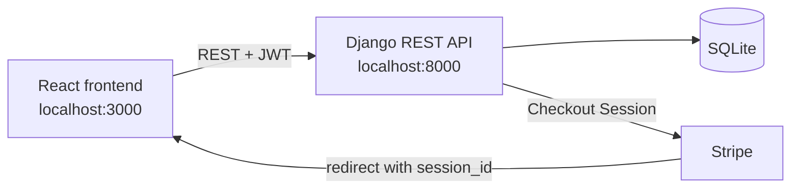

# MealMarket: Homemade Meal Subscriptions

A full-stack marketplace where customers subscribe to home-cooked meal plans and pay through Stripe Checkout. It has a Django REST API backend with JWT authentication and a React frontend.

Team project for BTP405 at Seneca Polytechnic, Winter 2025, built over two sprints.


## Features

- **Browse meal plans** by diet type (vegetarian, non-vegetarian, vegan), with prices managed in the Django admin
- **JWT authentication** using Simple JWT: login, token refresh and token verification
- **Subscription checkout**: pick a plan and meals per day, see a live price calculation, then pay through Stripe Checkout (test mode)
- **Payment verification**: after Stripe redirects back, the backend confirms the session with Stripe and saves the subscription and delivery address

## Architecture (as built)



The [planning diagram](docs/architecture.png) shows the wider target design from Sprint 1 (PostgreSQL, notifications, delivery tracking). This repo implements the core subscription and payment flow.

## API

| Method | Route | Description |
|---|---|---|
| `GET` | `/api/meals/` | List diet plans |
| `POST` | `/api/token/` | Log in and get access + refresh tokens |
| `POST` | `/api/token/refresh/` | Refresh an access token |
| `POST` | `/api/token/verify/` | Verify a token |
| `POST` | `/api/create-checkout-session/` | Create a Stripe Checkout session for a subscription |
| `GET` | `/api/verify-payment/?session_id=…` | Confirm payment with Stripe |
| `POST` | `/api/save-delivery-address/` | Save the subscription's delivery details |

## Run it locally

You'll need Python 3.10+, Node.js 18+ and a free Stripe account in test mode.

**Backend**

```bash
cd backend
python -m venv venv
source venv/bin/activate          # Windows: venv\Scripts\activate
pip install -r requirements.txt

cp .env.example .env              # add your Stripe test keys
python manage.py migrate
python manage.py createsuperuser  # to add meal plans in /admin
python manage.py runserver
```

**Frontend**

```bash
cd frontend
npm install
cp .env.example .env              # add your Stripe publishable test key
npm start
```

Open http://localhost:3000. Use Stripe's test card `4242 4242 4242 4242` with any future expiry date and any CVC.

## Project structure

```
backend/
  backend/        Django settings and URL routing
  meals/          Diet plan and subscription models, Stripe checkout views
  meals/api/      DRF serializers and views
frontend/
  src/components/ Meal list, subscription modal, login, payment success page
  src/context/    Auth context (JWT storage and refresh)
docs/             Architecture diagram, personas and user stories
```

## Docs

- [Personas and user stories](docs/personas_user_stories.md)
- [Planning architecture diagram](docs/architecture.png)
